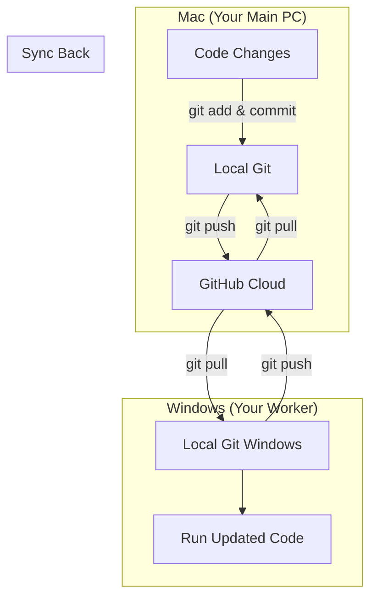

# Aergia Studio: Cross-Platform Workflow

This guide explains how to work on Aergia Studio from both **Mac** (Primary) and **Windows** (Secondary) without breaking things.

## Visual Guide (The Loop)


## 1. Setup (First Time)

### On Mac & Windows
1.  **Pull Latest Code**:
    ```bash
    git pull origin main
    ```
2.  **Install Unified Dependencies**:
    ```bash
    pip install -r requirements_cross_platform.txt
    ```

## 2. Platform-Specific Notes

### Mac (macOS)
-   **Permissions**: `Project Midas` needs **Screen Recording** permission.
    -   Go to `System Settings > Privacy & Security > Screen Recording`.
    -   Allow your Terminal (iTerm, Terminal) or IDE (VSCode, Cursor).
    -   *If Midas fails, it will now show a helpful error instead of crashing.*

### Windows
-   **Paths**: API paths are now automatically handled. `Project Plutus` can find `Schwab API` even though it lives inside Midas.
-   **CMD/PowerShell**: Use the provided `.bat` files for easy launching.

## 3. Git Rules (The "Golden Rule")

**NEVER commit local configuration files.**

The `.gitignore` should already handle this, but double-check you are NOT committing:
-   `.env` (API Keys)
-   `venv/` (Virtual Environment)
-   `__pycache__/`

### How to Sync Work
1.  **On Mac**: Make changes -> `git add .` -> `git commit -m "Update"` -> `git push`.
2.  **On Windows**: `git pull` -> Review changes -> Resume work.

## 4. Troubleshooting

**"Module not found: schwab_api"**
-   This is fixed in `plutus_treasury.py` by dynamically adding the path. If it persists, ensure `Project Midas` folder exists and has an `__init__.py` (or is a valid package).

**"Screen Capture Failed"**
-   On Mac: Check Permissions.
-   On Windows: Ensure no full-screen games are blocking the view.
